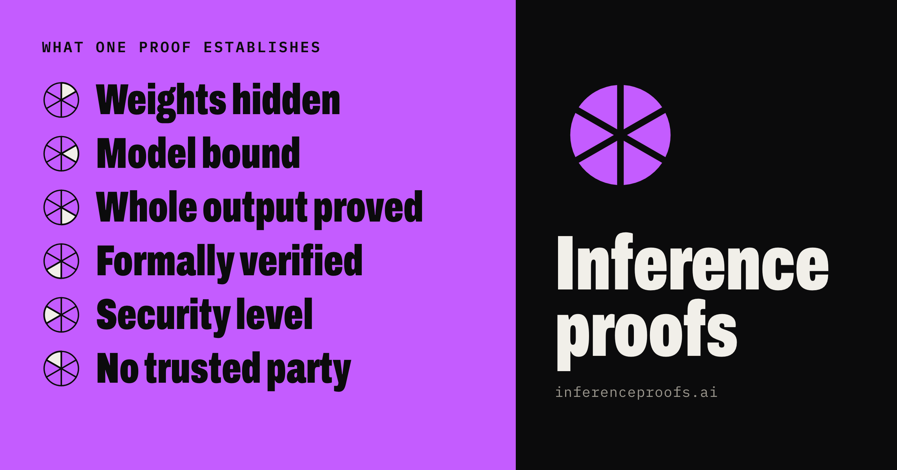
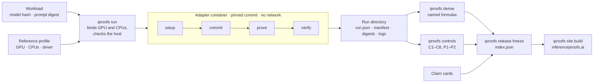

<div align="center">

<a href="https://www.inferenceproofs.ai"></a>

<h1>Inference Proofs</h1>

<p><strong>An open, neutral benchmark for provable inference.</strong><br>
The same models, the same reference hardware, the same timing rules,<br>
and a claim card beside every number saying what the proof establishes.</p>

<a href="https://github.com/ai-verification-observatory/inference-proofs/actions/workflows/ci.yml"></a>
<a href="releases/v0.1/release.yaml"></a>
<a href="https://www.inferenceproofs.ai"></a>
<br>
<a href="pyproject.toml"></a>
<a href="https://docs.astral.sh/uv/"></a>
<a href="docs/spec/07-testing-strategy.md"></a>
<a href="https://docs.astral.sh/ruff/"></a>
<br>
<a href="rfcs/README.md"></a>
<a href="LICENSE"></a>
<a href="LICENSES/CC-BY-4.0.txt"></a>
<a href="CONTRIBUTING.md"></a>

<p>
<a href="https://www.inferenceproofs.ai"><b>Results</b></a> ·
<a href="https://www.inferenceproofs.ai/learn"><b>Learn</b></a> ·
<a href="docs/SPEC.md"><b>Specification</b></a> ·
<a href="rfcs/README.md"><b>RFCs</b></a> ·
<a href="docs/PRD.md"><b>PRD</b></a> ·
<a href="systems/README.md"><b>Add a system</b></a> ·
<a href="docs/spec/10-glossary.md"><b>Glossary</b></a>
</p>

</div>

---

## Contents

- [Why this exists](#why-this-exists)
- [What gets measured](#what-gets-measured)
- [Anatomy of a number](#anatomy-of-a-number)
- [The claim card](#the-claim-card)
- [Timing scopes](#timing-scopes)
- [Negative controls](#negative-controls)
- [How a run works](#how-a-run-works)
- [Release v0.1](#release-v01)
- [Quick start](#quick-start)
- [Repository layout](#repository-layout)
- [Principles and non-goals](#principles-and-non-goals)
- [Contributing](#contributing)
- [Licence](#licence)

---

## Why this exists

Several open systems can now prove that a language model produced a given output. Each publishes its own numbers, and no two of them can be read side by side, because four things differ at once:

| Differs | Example of the gap | What this benchmark fixes |
|---|---|---|
| **Model** | an 8B dense model vs a mixture-of-experts model at another precision | pinned [workloads](rfcs/0003-workloads.md): model by public source and content hash, prompt sets by digest |
| **Hardware** | each author's own machine and driver | pinned [reference profiles](rfcs/0006-reference-hardware-and-cost.md) with a machine record and CPU binding |
| **Timing rule** | "proving time" that does or does not include start-up, commitment or batching | named [timing scopes](#timing-scopes), measured by the harness from outside the prover |
| **Claim** | one proof binds the weights, another samples, a third proves a single layer | a [claim card](#the-claim-card) per configuration, copied from the system's own documentation |

The first three can be removed. The fourth cannot: two systems that prove different statements are not faster or slower than each other, they are doing different work. So this project removes the differences it can and **labels the one it cannot**. It is in the spirit of [Ethproofs](https://ethproofs.org/) for zkVM provers, with one addition that inference needs: the claim card.

> [!IMPORTANT]
> This project **runs** provers and ranks them inside one model's rung by one measured figure, the cost of a proved reply as a multiple of serving it, among the systems that pass six checks we run ourselves ([RFC-0018](rfcs/0018-level-1-ladder.md)). It does not build or certify them, and it ranks nothing across models.

## What gets measured

Each system runs **unchanged**, at a full commit hash, inside a network-less container behind a five-subcommand [adapter contract](rfcs/0005-adapter-contract.md):

```
info → setup → commit → prove → verify
```

The harness times every call and every proof release from outside the container ([RFC-0011](rfcs/0011-measurement-and-sampling.md)), samples GPU and host resources through NVML and cgroups, runs the same tampering controls against every verifier ([RFC-0008](rfcs/0008-negative-controls.md)), and recomputes every derived figure in CI from the raw records ([RFC-0004](rfcs/0004-metrics-timing-grades.md)).

Each system is also set beside **reference rows** ([RFC-0015](rfcs/0015-reference-rows.md)): the same model served by a production engine (vLLM, publisher's release precision, defaults only) on the same GPU generation. The overhead of proving is read against that row, in GPU-seconds per token, with its scope on the label.

## Anatomy of a number

No number exists in this repository without its labels (one `quantity/1` type, [RFC-0012](rfcs/0012-schemas-and-serialization.md)). This is one, verbatim, from a stored v0.1 run:

```jsonc
// results/v0.1/sash/2026-11-09-sash-sash-l31-8b-c1024-prover-h200-hosted-1/run.json
"active_param_tokens_per_second_prove.session": {
  "value": 1669204795.273114,
  "unit": "param_token/s",
  "scope": "prove.session",          // which clock events bound it
  "grade": "derived",                // how it was obtained
  "tier": "reported",                // who stands behind it
  "null_reason": null,
  "source": {
    "kind": "derivation",
    "ref": "derive:D-APT-S@0.1.0.dev0", // formula id and harness version
    "inputs": [
      ".../run.json#/metrics/rate_prove.session",
      ".../run.json#/inputs/active_parameters_per_token"
    ]
  }
}
```

Three vocabularies label it. Each is normative in the RFC named beside it.

<table>
<tr><th>Grade: how it was obtained<br><sub><a href="rfcs/0004-metrics-timing-grades.md">RFC-0004</a></sub></th><th>Evidence tier: who stands behind it<br><sub><a href="rfcs/0007-evidence-tiers-and-reproduction.md">RFC-0007</a></sub></th><th>Wording: what a proof does<br><sub><a href="docs/spec/10-glossary.md">Glossary</a></sub></th></tr>
<tr valign="top"><td>

| Grade | Meaning |
|---|---|
| `measured` | read by the harness from this project's run |
| `derived` | computed by CI by a named formula |
| `projected` | from a named cost model |
| `external` | read from a public source at a pin |
| `asserted` | an input (a price) with source and date |

</td><td>

| Tier | Meaning |
|---|---|
| `reported` | one runner, not yet checked |
| `peer-reviewed` | checked by someone from another organisation |
| `reproduced` | rerun by an unaffiliated runner within tolerance |

Only `reproduced` numbers are called *measured* in prose.

</td><td>

| Word | Use |
|---|---|
| **proved** | a sound verifier's acceptance establishes it |
| **bound** | an edge the verifier's acceptance constrains |
| **sampled** | a random subset was checked; statistical |
| **attested** | vouched for by hardware or a signer |

Never "provably safe".

</td></tr>
</table>

Derived numbers are **computed, never typed**. CI recomputes every one from its inputs, bit for bit, and fails on any difference.

## The claim card

A claim card ([RFC-0002](rfcs/0002-claim-card.md)) is the machine-checkable statement, per system configuration, of what an accepted proof establishes: the relation, the security notion and level, the assumptions, which edges of the computation are bound, and the **residual**, what a cheating prover can still do while passing verification.

Every field is copied from the system's own documentation at the pinned commit, with a line-anchored link, or written `not stated` where the source is silent. Nothing is inferred. An excerpt from [`systems/sash/claim.yaml`](systems/sash/claim.yaml):

```yaml
upstream: {repo: "sg-ai-safety-hub/zk-inference-prover", commit: "eb95bfa887299d1637550228d42086c27cbb2b3b"}
claim_class: "greedy-continuation/exact-match/committed-weights"
security:
  notion:
    kind: "not_stated"
  level: >-
    100 conjectured bits for each segment proof, by stwo's own conjectured-soundness accounting
    [...] A level for the whole grid of segments is not stated.
zero_knowledge: {claimed: "not stated", hidden: "not stated", not_hidden: "not stated", status: "not_stated"}
```

A system enters the ranking by passing six checks we run ourselves ([RFC-0018](rfcs/0018-level-1-ladder.md#the-six-checks)):

| Check | Held when |
|---|---|
| **Run** | three cold sessions, built from the public pin, unpatched, each returned an accepted proof for every request |
| **Model** | a proof made after changing one committed weight was never accepted, and an honest proof was refused against another commitment |
| **Prompt** | a proof was refused for a prompt with one token changed |
| **Reply** | proofs cover all 512 reply tokens, and a changed token at the first, the last and an interior position was refused |
| **No weight file** | every verdict came from a verify call with no GPU and no model file, under a file-open trace |
| **Fidelity** | the committed copy's replies follow the publisher's model for longer than a named damaged copy's |

None of the checks attempts a forged proof: soundness and weight secrecy are not tested.

The glyph then shows how far a system that ran is from a perfect prover ([RFC-0018](rfcs/0018-level-1-ladder.md#the-glyph)). Five petals, each green (holds in full), amber (in part), red (not at all, or not stated) or hollow (not yet measured):

| Petal | Green means |
|---|---|
| **Unforgeable** | a proven soundness level of at least 128 bits for the verifier code run |
| **Weights hidden** | zero knowledge proven for the program run, no leak beyond public sizes |
| **Faithful model** | replies not distinguishable from the publisher's own model |
| **Any model** | passed on every model of the level |
| **Only the verifier trusted** | soundness rests on cryptographic assumptions alone; no setup ceremony, hardware key or third party |

Unforgeable, Weights hidden and Only the verifier trusted are read from the publisher's statements at the pin (`systems/<name>/properties.yaml`); a failed check turns them red. The glyph never moves a position: the order is cost among the systems that passed.

## Timing scopes

Every time and every rate names exactly one scope ([RFC-0004 INV-SCOPE-1](rfcs/0004-metrics-timing-grades.md#timing-scopes)). Boundaries are harness clock events (`time.monotonic_ns()`); a proof's release time is the instant the harness observes its atomic rename into `/io/proofs/`.

| Scope | Starts at | Ends at | Tokens attributed |
|---|---|---|---|
| `commit` | `commit` call start | `commit` call exit | none |
| `prove.session` | `prove` call start | release of the last proof | all proofs |
| `prove.steady` | last release in the first batch | release of the last proof | requests after the first batch |
| `whole_wall` | `commit` call start | release of the last proof | all proofs |
| `verify` | `verify` call start, 8-CPU verifier | that call's exit | the proof's tokens |
| `verify.single_thread` | same, 1-CPU verifier | that call's exit | the proof's tokens |

`prove.steady` excludes start-up; `prove.session` includes it. A system that releases no proof before the whole request is proved has no steady scope, and its headline says so on the label.

## Negative controls

A benchmark that only times honest runs cannot tell a verifier from one that accepts everything. Every verifier faces the same tampering controls ([RFC-0008](rfcs/0008-negative-controls.md)), applied by the harness, never by the system:

| Id | Tampering | Expected |
|---|---|---|
| C1 | change the claimed output token | `reject` |
| C2 | change one prompt token in the request | `reject` |
| C3 | verify against the commitment of perturbed weights | `reject` |
| C4 | replay a valid proof for a different request | `reject` |
| C5 | truncate the largest part the verifier reads | `reject` or `invalid_call` |
| C6 | flip one bit at a seeded offset in a part the verifier reads, 5 seeds | `reject` or `invalid_call`, each seed |
| C7 | swap the proofs of two requests in one batch | `reject` |
| C8 | drop one part the verifier reads | `reject` or `invalid_call` |
| P1 | commit W, prove with perturbed W′ | `prover_failed` or `reject` |
| P2 | prove at a precision other than the committed one | `prover_failed` or `reject` |

Each control has an **honest twin**: the untouched proof, verified in the same batch with the same image. If the twin is not accepted, the control is `void`, never counted as a rejection. Switches that weaken a system's statement (for example SASH's `--unsound-skip-*`) run only in control jobs, where their documented acceptance is the expected outcome, and never produce a measured row.

## How a run works



The commitment the verifier checks is taken from the harness's own record of the `commit` step, never from files shipped with a proof. Proof bytes are archived in a public dataset at URIs pinned to the dataset commit ([RFC-0009](rfcs/0009-results-and-publication.md), [RFC-0014](rfcs/0014-provenance-and-integrity.md)).

## Release v0.1

Release v0.1 is frozen in [`releases/v0.1/`](releases/v0.1/): two systems on their native workloads, plus production-serving reference rows, on NVIDIA H200 141 GB hosted profiles ([RFC-0006 §H200 profiles](rfcs/0006-reference-hardware-and-cost.md#h200-profiles)). Every configuration in it is at evidence tier `reported`: one runner, not yet peer-reviewed or reproduced.

| System | Pinned upstream | Native workload | Claim card |
|---|---|---|---|
| SASH zk-inference-prover | [`sg-ai-safety-hub/zk-inference-prover@eb95bfa`](https://github.com/sg-ai-safety-hub/zk-inference-prover/tree/eb95bfa887299d1637550228d42086c27cbb2b3b) | Llama 3.1 8B, W8A8 (`sash-l31-8b-c1024`) | [`sound-defaults`](systems/sash/claim.yaml) |
| FlashProve | [`anthropics/FlashProve@9e2bdd8`](https://github.com/anthropics/FlashProve/tree/9e2bdd8ff5bf9c62f18263d7dac189b0400b260c) (v0.16.0) | Llama 4 Maverick, 4-bit GGUF (`fp-maverick-w1024-b1`, `-b24`) | [`exact-match-cp-verify`](systems/flashprove/claim.yaml) |
| Production serving (reference) | vLLM v0.32.0 | the same models at the publisher's release precision | not a proof |

Native rows sit side by side, never head to head: the systems prove different statements on different models. The figures, with their scopes, sample sizes and ranges, are on **[inferenceproofs.ai](https://www.inferenceproofs.ai)** and in [`releases/v0.1/index.json`](releases/v0.1/index.json); this README quotes none, so it cannot drift from them.

> [!NOTE]
> One control outcome sits outside its expected set and is kept as recorded: a C6 bit flip on FlashProve run `2026-11-08-…-b1-prover-h200-hosted-3` landed in a proof part the adapter's `verify` does not read, and was accepted. That is a gap in the control design, not a finding against FlashProve; the [RFC-0008 amendment](rfcs/0008-negative-controls.md) now restricts C5, C6 and C8 to the parts a verifier declares it reads. Stored records are never rewritten; a rerun is a new record.

## Quick start

The harness is one Python package, `iproofs` (Python 3.12 or 3.13), managed with [uv](https://docs.astral.sh/uv/). Everything below runs on a laptop, with no GPU.

```bash
git clone https://github.com/ai-verification-observatory/inference-proofs
cd inference-proofs
uv sync
uv run iproofs --version
```

**Check the whole repository** the way CI does: schemas, claim cards, derivations, pins, licences, neutral language ([RFC-0013](rfcs/0013-validation-and-ci.md)).

```bash
uv run iproofs validate --all
make ci          # lint, mypy --strict, tests, coverage gate, validate
```

**Recompute a stored run's derived metrics** from its raw records and compare them bit for bit:

```bash
uv run iproofs derive --check results/v0.1/sash/2026-11-09-sash-sash-l31-8b-c1024-prover-h200-hosted-1
```

**Build the site** from the newest frozen release (`iproofs.site` computes every value a page prints; `web/build.py` draws the pages; every page reads in full without script):

```bash
uv run iproofs site build            # writes web/
uv run iproofs site build --out DIR  # a complete site in any other directory
```

Optional extras install only where they are needed: `--extra gpu` (NVML sampling on a GPU host), `--extra fetch` (model download), `--extra prompts` (tokenizers). Runs on GPU hosts follow the runbooks in [`docs/runbooks/`](docs/runbooks/).

<details>
<summary><b>Every command</b></summary>

| Command | What it does | RFC |
|---|---|---|
| `iproofs validate` | run every CI check on the given paths | [0013](rfcs/0013-validation-and-ci.md) |
| `iproofs run` | run jobs of one system on one workload | [0010](rfcs/0010-harness-runner.md) |
| `iproofs derive` | compute derived metrics of a run directory | [0004](rfcs/0004-metrics-timing-grades.md) |
| `iproofs controls` | run the negative-control suite against a run | [0008](rfcs/0008-negative-controls.md) |
| `iproofs machine-record` | print the machine record as JSON | [0006](rfcs/0006-reference-hardware-and-cost.md) |
| `iproofs fetch-model` | fetch a workload's weights and check every hash | [0014](rfcs/0014-provenance-and-integrity.md) |
| `iproofs prompts` | build and check prompt sets | [0003](rfcs/0003-workloads.md) |
| `iproofs serving` | production-serving records | [0015](rfcs/0015-reference-rows.md) |
| `iproofs reproduce` | reproduction records | [0007](rfcs/0007-evidence-tiers-and-reproduction.md) |
| `iproofs release` | freeze a benchmark release | [0009](rfcs/0009-results-and-publication.md) |
| `iproofs site` | build the static site | [0009](rfcs/0009-results-and-publication.md) |
| `iproofs archive` | upload and pin proof archives | [0014](rfcs/0014-provenance-and-integrity.md) |

</details>

## Repository layout

```
inference-proofs/
├── rfcs/           normative decisions (sources of truth, in order: RFCs, spec, PRD)
├── docs/
│   ├── PRD.md      why, for whom, scope, roadmap
│   ├── SPEC.md     index and executive summary of the specification
│   ├── spec/       sections 00 to 10, overview to glossary
│   └── runbooks/   GPU-host procedures
├── schema/         JSON Schemas, each with valid and invalid examples
├── harness/        the iproofs package and its tests
├── systems/        one adapter per system: Dockerfile, system.yaml, claim.yaml, controls
├── workloads/      pinned models, prompt corpus, serving records
├── reference/      hardware profiles and price basis
├── results/        run directories, one per run, never edited after the fact
├── releases/       frozen benchmark releases
└── web/            the public site, built from the newest release
```

## Principles and non-goals

| We do | We do not |
|---|---|
| put a claim card beside every number | publish a number without its scope, grade, tier and source |
| run provers unchanged, at pinned commits | patch, tune or fork a prover |
| report ranges and sample sizes | report a single "best" run |
| record failed runs with their exit code and last lines | drop or round away a result |
| apply the same controls to every verifier | let a system choose its own tests |
| copy what systems state, and write `not stated` | infer a security property |
| rank passed systems inside one rung by the order rule | rank across rungs, score, certify or crown |


## Contributing

Open an issue or a pull request ([CONTRIBUTING.md](CONTRIBUTING.md)). To add a system, follow the adapter guide, [systems/README.md](systems/README.md).

## Licence

Code is licensed under [Apache-2.0](LICENSE). Specifications, data, results and reports are licensed under [CC BY 4.0](LICENSES/CC-BY-4.0.txt).

The boundary:

- Code (Apache-2.0): `harness/`, `systems/*/` (except `claim.yaml`, `claims/` and `external.yaml`), `site/` templates, `schema/` and CI configuration.
- Documents and data (CC BY 4.0): `docs/`, `rfcs/`, `workloads/`, `reference/`, `results/`, `releases/`, `targets/`, `reports/`, `web/learn/` (the text of the site's Learn pages), and claim cards and external figures.
- A file that fits neither list is code.

<div align="center">
<sub>Run by us, ranked inside a rung. Labelled, not rounded. Proved, bound, sampled or attested, and said which.</sub>
</div>
